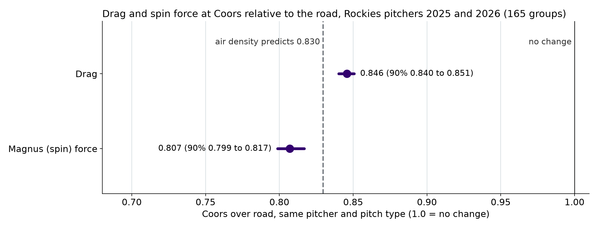
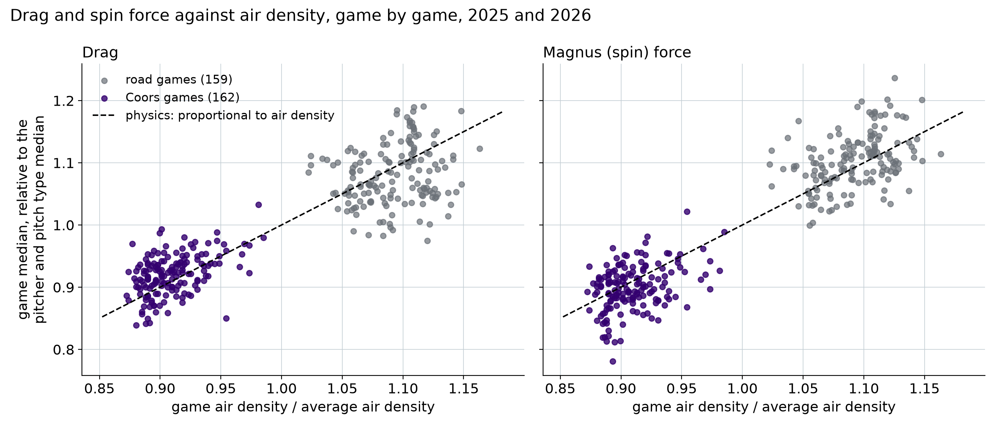
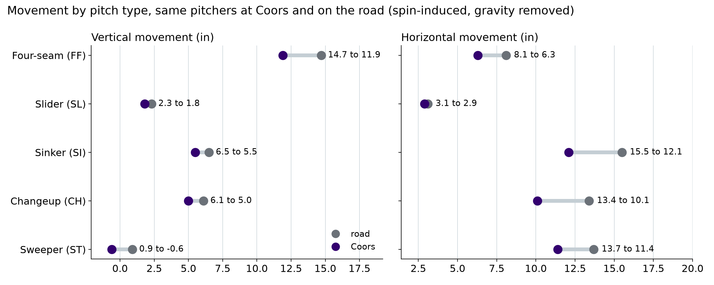
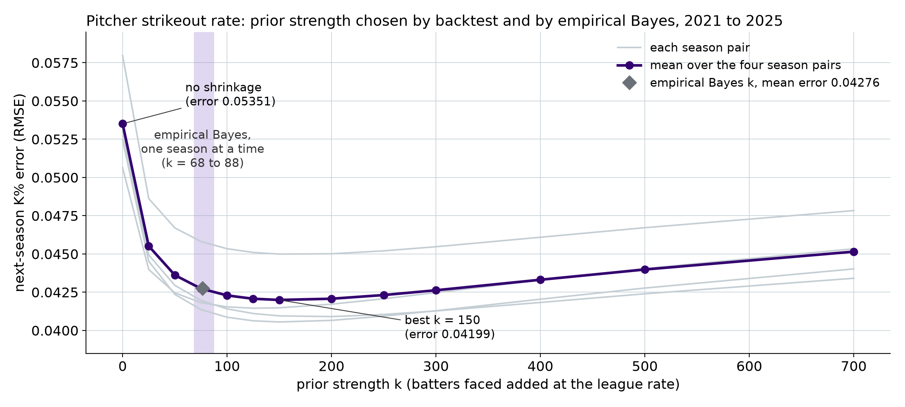
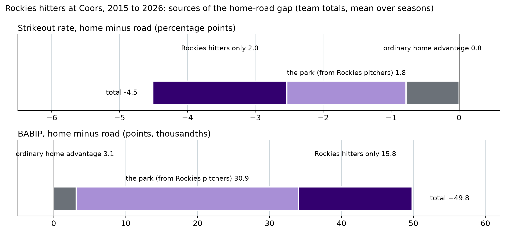
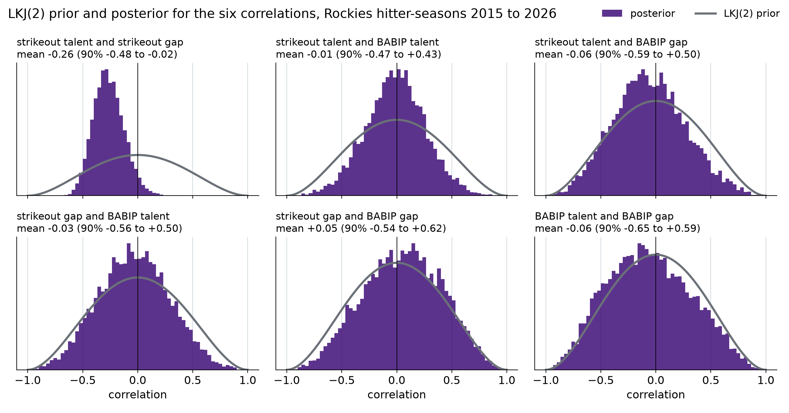
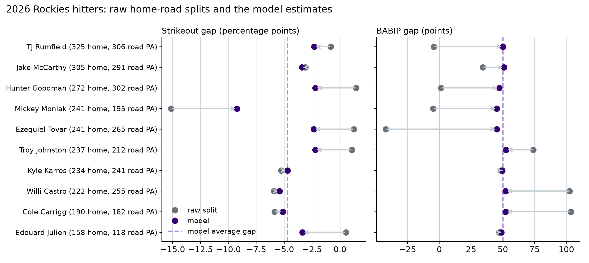
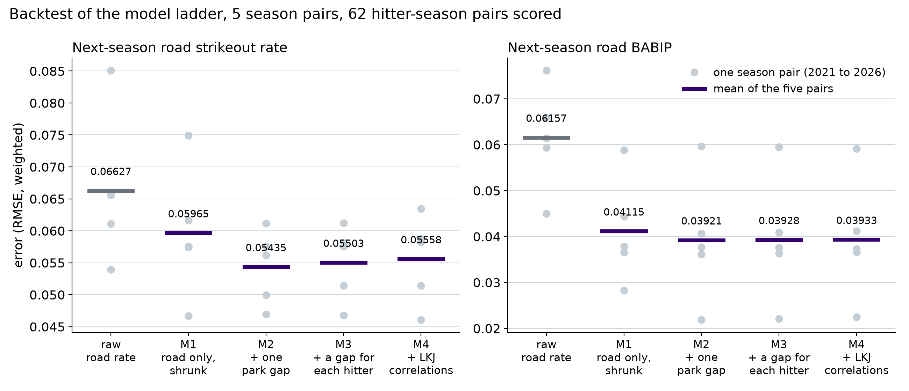

# Coors Field forecasting analyses

Three short analyses of how Coors Field changes what a forecast should expect, written in November 2026 for a discussion with the Colorado Rockies Forecasting research group. Each script runs top to bottom in numbered steps, saves its figures next to itself, and carries its printed results pasted back in as `####` comment blocks, so the results can be read without running anything.

| Script | Question | Answer |
|---|---|---|
| `coors_air_density_v2.py` | Does pitch movement at Coors fall by the amount that air density predicts? | Mostly: drag fell to 0.846 and the spin (Magnus) force to 0.807 of their road values, against 0.830 predicted from air density. Swings and misses per swing did not fall. |
| `prior_strength_eb_vs_backtest_v2.py` | How strong should the prior be when a pitcher's strikeout rate is shrunk toward the league rate? | Empirical Bayes picks about 77 batters faced; the next-season forecast wants about 150. Empirical Bayes still gets 93 percent of the gain over no shrinkage. |
| `coors_hitters_lkj_v2.py` | How much of a Rockies hitter's home-road gap belongs to the hitter, and does knowing it help forecast his road line? | The BABIP gap is about the same for every hitter (a park effect); the strikeout gap varies by hitter and is larger for hitters who strike out more on the road (correlation −0.26). Neither the hitter-specific gaps nor the correlations improved next season's road forecast. |

## Air density and pitch movement

Statcast fits a constant acceleration to every pitch. After removing gravity, the component along the velocity is drag and the component perpendicular to it is the spin-induced (Magnus) force; both are proportional to air density times speed squared ([Nathan, The Physics of Baseball: Denver](https://baseball.physics.illinois.edu/Denver.html)). Dividing each by speed squared leaves a quantity that should scale with air density for a given pitcher and pitch type. The data are Rockies pitchers only (2025 and 2026 regular seasons, 48,175 pitches by 54 pitchers), so each pitcher is compared with himself: 165 pitcher, pitch type, and season groups (35 pitchers) with at least 30 pitches at Coors and 30 on the road. Air density for each game comes from the game-time temperature and the park's elevation (MLB Stats API), with standard-atmosphere pressure and dry air.

*Figure 1 of `coors_air_density_v2.py`. The air at Coors was 0.830 times as dense as in the same pitchers' road games. Drag came out at 0.846 (90 percent bootstrap interval over pitchers, 0.840 to 0.851) and the Magnus force at 0.807 (0.799 to 0.817). The 2025 and 2026 seasons agree.*

*Figure 2. Game by game, the slope of relative drag on relative air density is 0.85 over all games, and 1.08 for the Magnus force (physics predicts 1). That slope comes mostly from Coors against everywhere else; among road games alone it is 0.30 and 0.58.*

*Figure 3. Velocity and spin barely change (four-seamers 0.18 mph slower and 25 rpm higher in spin at Coors), but total break falls by 15 to 23 percent across the five main pitch types. A four-seamer's vertical movement drops from 14.7 to 11.9 inches.*

The result I can't explain is that the same pitchers got as many swings and misses per swing at Coors as on the road: 0.209 against 0.200 for all pitches, and 0.138 against 0.150 for four-seamers (90 percent interval for that difference −0.027 to +0.004). So I would not scale a pitch model's inputs by air density and assume the outcomes follow without testing it.

Limits: Rockies pitchers only; standard pressure and dry air (humidity and the day's pressure are each worth about 1 to 2 percent of air density); camera calibration could differ by park; and home and road opponents differ.

## Prior strength for strikeout-rate shrinkage

An earlier strikeout projection of mine shrank each pitcher's strikeout rate (K%) toward the league rate with a constant k:

    shrunk K% = (K + k × league K%) / (TBF + k)

where K is strikeouts and TBF is total batters faced. That is the posterior mean of a beta-binomial model whose Beta prior has its mean at the league rate and strength α + β = k, so k is a prior hyperparameter. The script sets k two ways on FanGraphs pitcher seasons from 2021 to 2025 (4,062 pitcher seasons):

- Empirical Bayes: maximize the beta-binomial marginal likelihood of one season's strikeout counts. This gives k = 68 to 88 batters faced (mean 77), which means true strikeout talent has a standard deviation of 0.044 to 0.050.
- Backtest: shrink season t and score against season t + 1, by root-mean-square error (RMSE) weighted by next season's batters faced. The best k was 125 to 200 depending on the season pair, and 150 over all four pairs.

*Figure 1 of `prior_strength_eb_vs_backtest_v2.py`. Shrinkage is the big gain: the error is 0.05351 with no shrinkage and 0.04199 at k = 150. Empirical Bayes reaches 0.04276, which is (0.05351 − 0.04276) / (0.05351 − 0.04199) = 93 percent of that gain, with a prior about half as strong as the forecast wants.*

The difference is talent changing between seasons, which one season's likelihood cannot see. A model in which talent drifts from season to season (a state-space model, fit by its marginal likelihood across seasons) would estimate both at once; the backtest k stands in for it.

Limits: the best k is chosen and scored on the same four season pairs, which flatters it slightly (the curve is flat from 125 to 200), and starters and relievers share one prior, which was not tested against separate priors.

## Coors gaps for Rockies hitters

This is my first Stan model, written in November 2026 to learn the Lewandowski-Kurowicka-Joe (LKJ) prior for correlation matrices ([Lewandowski, Kurowicka, and Joe, 2009](https://doi.org/10.1016/j.jmva.2009.04.008)). The data are MLB Stats API home and road splits for every Rockies hitter except pitchers, 2015 to 2026 without 2020: 242 hitter-seasons from 114 hitters, with 32,940 plate appearances at home and 32,360 on the road. The player splits add up to the team totals in every season.

### Model

For one hitter-season in season s, with logit(p) = ln(p / (1 − p)):

- logit P(strikeout, road) = μ_s + u₁
- logit P(strikeout, home) = μ_s + g_K + u₁ + u₂
- logit P(hit on a ball in play, road) = ν_s + u₃
- logit P(hit on a ball in play, home) = ν_s + g_B + u₃ + u₄
- (u₁, u₂, u₃, u₄) ~ MVN(0, Σ), with Σ = diag(τ) Ω diag(τ), τ_k ~ half-normal(0, 0.5), and Ω ~ LKJ(2)

Here μ_s and ν_s are the season's road strikeout and BABIP levels, g_K and g_B are the average Coors gaps, and u₁ to u₄ are the hitter-season's road strikeout talent, own strikeout gap, road BABIP talent, and own BABIP gap. LKJ(2) keeps Ω a valid correlation matrix and pulls each of its six correlations gently toward 0: for η = 2 and K = 4 the prior SD of one correlation is 1/√(2η + K − 1) = 1/√7 = 0.378. In Stan the prior goes on the Cholesky factor of Ω (`L ~ lkj_corr_cholesky(2)`, [Stan Functions Reference](https://mc-stan.org/docs/functions-reference/correlation_matrix_distributions.html)), and the effects are written non-centered, u = diag(τ) L z with z standard normal.

### Checks

- Recovery: outcomes simulated from known τ and Ω on the real plate-appearance counts, then refit. All 10 true values fell inside their 90 percent intervals.
- Null case: the same simulation with Ω equal to the identity. The strikeout talent and strikeout gap correlation came out at +0.09 (−0.39 to +0.58), so the model does not manufacture the one correlation it finds in the real data. One of the six null intervals excluded 0 (+0.34), about the one-in-ten rate expected of 90 percent intervals.
- The LKJ formula: correlations drawn from the LKJ(2) prior had SD 0.377, against 0.378 from the formula.
- Convergence: every fit has R-hat at or below 1.01 and no divergent transitions ([Vehtari and others, 2021](https://doi.org/10.1214/20-BA1221)).
- Sensitivity: refit at η = 1 and η = 4.

### Results

*Figure 1 of `coors_hitters_lkj_v2.py`. Rockies hitters strike out 4.5 percentage points less at home and gain 50 points of BABIP; the other 29 teams' hitters, 0.8 percentage points and 3 points. Rockies pitchers at home face visiting hitters at Coors, so their home-road split puts the park itself at about 1.8 percentage points of strikeouts and 31 points of BABIP. That leaves about 2.0 and 16 specific to Rockies hitters: a road hangover, home familiarity, or both. This is rough arithmetic on season means, and it assumes Coors affects visiting and Rockies hitters equally.*

The model's average Coors gap is −0.047 strikeouts per plate appearance (90 percent interval −0.054 to −0.040) at a road level of 0.259, and +0.050 of BABIP (+0.043 to +0.058). The strikeout gap varies from hitter to hitter (SD about 0.035 in rate); the BABIP gap barely does (about 0.008), so it behaves like a property of the park.

*Figure 2. Only one of the six correlations moved off the LKJ(2) prior: strikeout talent and strikeout gap, −0.26 (−0.48 to −0.02). Hitters who strike out more on the road gain more at Coors. It held at η = 1 (−0.27) and η = 4 (−0.25).*

*Figure 3. The ten 2026 hitters with the most home plate appearances, the ones shown, all get about the same model BABIP gap (+0.045 to +0.053) whatever their raw splits: Willi Castro's raw +0.103 becomes +0.052, and Ezequiel Tovar's raw −0.042 becomes +0.045. Strikeout gaps are shrunk toward the average, most for extreme gaps and small samples: Mickey Moniak's raw −0.152, the most extreme (241 plate appearances at home, 195 on the road), becomes −0.092, and Edouard Julien's raw +0.005, from the fewest plate appearances (158 and 118), becomes −0.034.*

### Forecasting backtest

Each model is fit on every season up to t and predicts each hitter's road strikeout rate and road BABIP in t + 1, scored by RMSE weighted by next season's road plate appearances (or balls in play), over five season pairs from 2021 to 2026.

| Model | Road K% RMSE | Road BABIP RMSE |
|---|---|---|
| Raw road rate, no model | 0.06627 | 0.06157 |
| M1: road results only, shrunk | 0.05965 | 0.04115 |
| M2: plus home results, one park gap for everyone | 0.05435 | 0.03921 |
| M3: plus a gap for each hitter | 0.05503 | 0.03928 |
| M4: plus the LKJ correlations | 0.05558 | 0.03933 |

*Figure 4. Shrinkage does most of the work, and home results with one park factor help more. The hitter-specific gaps and the LKJ correlations did not improve next season's road forecast. Only 62 hitter-season pairs are scored (11 to 14 per season pair, the hitters who stayed with the club, 31 different hitters in all), so the differences among M2, M3, and M4 are within the noise.*

I would use the richer model to describe how Coors works, and the simpler one to forecast until there is enough data to show the richer one earns its place.

Limits: each hitter-season is its own unit, so the same hitter's seasons are not linked (a hitter effect that drifts from season to season would use more of the data); home minus road mixes the park, ordinary home advantage, and any hangover, which the arithmetic above separates only roughly; hitters traded during a season count only their Rockies plate appearances; and the prior on the spreads τ (half-normal(0, 0.5)) was not varied, so the near-zero BABIP spreads, the estimates most likely to depend on it, are untested against it.

## Running the scripts

Python 3 with numpy, pandas, scipy, matplotlib, and cmdstanpy, plus a CmdStan installation for the Stan model (tested with CmdStanPy 1.3.2 and CmdStan 2.40.0).

    python coors_air_density_v2.py               # about 1 minute after the first run, which downloads the pitches
    python prior_strength_eb_vs_backtest_v2.py   # a few seconds; needs data/k_2026.csv (below)
    python coors_hitters_lkj_v2.py               # about 8 minutes; compiles the Stan model on the first run

Data go in `data/` and are not committed, except `data/player_positions.csv` (each player's primary position, from the MLB Stats API). Two scripts download their own data on the first run: `coors_air_density_v2.py` from the [Baseball Savant Statcast search](https://baseballsavant.mlb.com/statcast_search) and the MLB Stats API schedule, and `coors_hitters_lkj_v2.py` from the MLB Stats API (`statsapi.mlb.com`) home and road splits. `prior_strength_eb_vs_backtest_v2.py` reads a [FanGraphs](https://www.fangraphs.com/leaders/major-league) pitching leaderboard export saved as `data/k_2026.csv`: seasons 2021 to 2025, one row per pitcher season, with the columns Season, Name, PlayerId (the MLBAM player id), Team, K% (as a fraction), and TBF.
