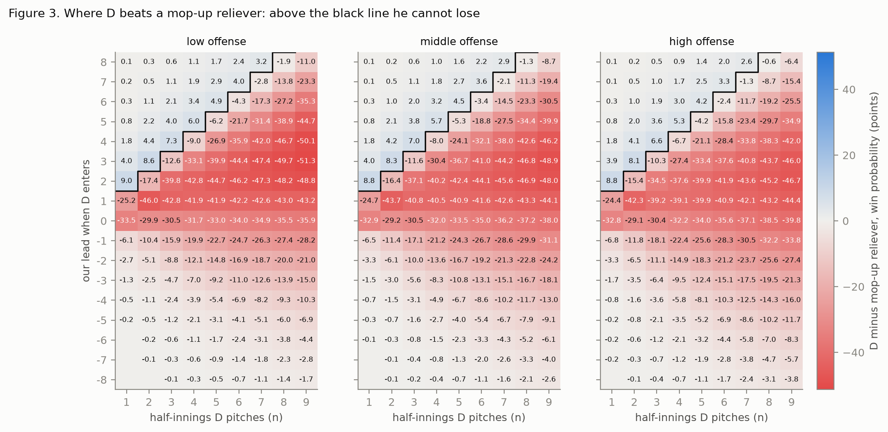
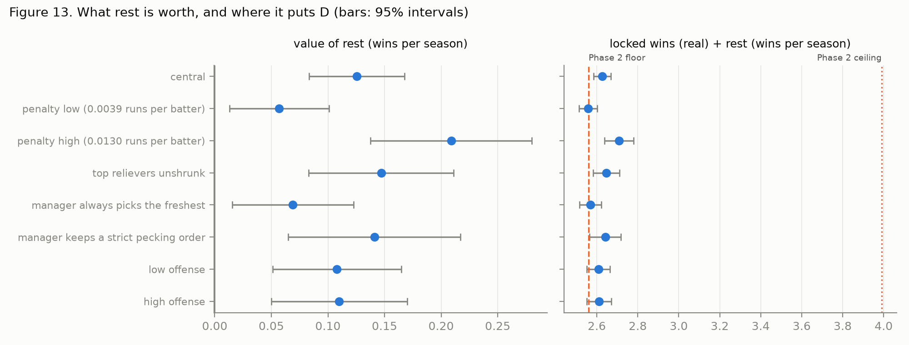

# The deterministic pitcher

A pitcher gives up a home run to the first batter of every inning he pitches and strikes out the next three, without exception, and he never tires or gets hurt. Is he worth a roster spot, in which games should he pitch, and how many wins is he worth? The question came from an interview in October 2026. This project answers it with Retrosheet play-by-play and game logs from 2022 to 2025 (the universal designated hitter seasons), in four phases. The scripts call him D.

| Phase | Script | Question | Answer |
|---|---|---|---|
| 1 | `scripts/phase1_analytic.py` | In which game states does D beat a real pitcher? | Only when our lead is larger than the number of half-innings left for the opponent; there he cannot lose, whatever our offense. Teams reached that state in about 63 games a season and lost 4.0 percent of them (2.5 games a season). |
| 2 | `scripts/phase2_ledger.py` | What else does he cost or buy (blowout innings, rest, the roster spot)? | Using him in blowout losses never pays. The lock rule alone is worth 2.56 wins a season at the floor and at most 3.99 at a ceiling that assumes every freed top-reliever appearance is redeployed. |
| 3 | `scripts/game_engine.py`, `scripts/phase3_engine_validation.py` | Can a plate-appearance simulator reproduce real games well enough to price rest? | Yes, within about 1 to 2 percent on scoring and 0.9 points of win expectancy on average. |
| 4 | `scripts/phase4_season.py` | What is rest for the bullpen worth over a season? | 0.13 wins a season (0.06 to 0.21 across every sensitivity case). D is worth 2.63 wins a season in total (2.56 to 2.71). |

`PLAN.md` is the working plan and the record of each phase's results, including the checks that failed.

## When he cannot lose

Phase 1 computes D's win probability for every lead L and number of opponent half-innings left n, from the empirical distribution of runs per half-inning at three offense levels, and compares it with a mop-up reliever (the 13th pitcher on the staff, whose roster spot D takes). With L > n, D concedes exactly n runs and the lead holds, which no real pitcher can promise. With L ≤ n he needs our offense to score, and there he is worse than the mop-up reliever in every state and for every offense level. A better offense narrows the gap by up to 8 points of win probability but never closes it, so the usage rule does not depend on the offense at all.

*Figure 3 of `phase1_analytic.py`. D's win probability minus a mop-up reliever's, in points, by our lead when he enters and the half-innings he would pitch. Above the black line (L > n) he cannot lose.*

The model adds per-inning run distributions as if innings were independent. It is calibrated within 2.2 points against real outcomes, with a Brier score (the mean squared error of a win probability) of 0.1615 against 0.1620 for an in-sample lookup table.

This turned the interview answer around. D is not a garbage-time arm: he is the best possible closer for any lead of 2 or more in the 9th (3 or more in the 8th, and so on).

## The rest of the ledger

Phase 2 prices everything else from the play-by-play. Blowout use loses wins at every threshold: 0.06 wins per 100 innings when trailing by 8 or more from the 6th inning on, 0.42 at 5 or more, 0.77 at 4 or more. The lock innings (about 166 a season) come from starters (31), the top three relievers (51) and other relievers (84), which is 1.8 to 1.9 times the work of an average bullpen slot. Pitching on consecutive days costs a reliever 0.33 runs per 9 innings (0.15 to 0.50) within the same pitcher-season.

## A game engine, and what rest is worth

Rest is the uncertain term, so Phases 3 and 4 simulate it. The engine plays each plate appearance from batter and pitcher rates combined by the odds-ratio rule, moves runners as they really moved in each base-out state, and gives each team a per-game factor (log-normal, spread 0.15) for day-to-day variation. It matches 2022 to 2025 within about 1 to 2 percent on scoring, scoreless and big innings, and pitch counts; run expectancy within 0.023 runs; and win expectancy within 0.9 points on average (Brier 0.1622 against 0.1620). It misses on extra innings (10.0 percent of games against 8.7 in reality) and plays every inning at the same scoring level.

Phase 4 plays 162-game seasons with five starters, three top relievers and five others, fatigue (a reliever is unavailable after two straight days or after 30 pitches the day before, and pays the back-to-back penalty), and a manager calibrated on three real measures. Each half-inning restarts its random numbers from the same seed in every version of a season, so the seasons with and without D are paired.

*Figure 13 of `phase4_season.py`. Left: the value of rest (D's gain with fatigue minus his gain if every pitcher were always fresh), with 95 percent intervals, for the central case and seven sensitivity cases. Right: locked wins from real games (2.50) plus rest, against the Phase 2 floor and ceiling.*

Rest is worth little because top relievers already start 93 percent of close-late half-innings without D, so the appearances he frees have almost nowhere better to go. Only 42 percent of the top relievers' advantage in one season persists into the next, and the simulation uses only the persistent part. Blowout use on top of the lock rule still costs 0.21 wins a season with rest valued in full.

## Limits

Injuries, call-ups and minor-league options, and mid-inning matchup changes are not modelled. The value of reliever rest rests on a back-to-back penalty estimated from observational data, in which tired relievers are used in different situations, so the sensitivity cases bracket it rather than settle it. Roster rules (the 13-pitcher limit, the automatic runner in extra innings) are those of 2022 to 2025.

## Running the scripts

Python 3 with numpy, pandas and matplotlib. Run the phases in order from the `scripts/` folder. Phase 4 imports `game_engine.py` and reads `results/phase3_engine_inputs.pkl`, which Phase 3 writes. `email_figures.py` redraws two Phase 1 figures to stand on their own (in `figures/email/`).

The data are not committed. Phase 1 reads the Retrosheet game logs `data/retrosheet/gl2022.txt` to `gl2025.txt` (unzipped from `https://www.retrosheet.org/gamelogs/gl2022.zip` and so on). Phases 2 to 4 read the Retrosheet season files in `data/retrosheet/csv/<year>/` (unzipped from `https://www.retrosheet.org/downloads/2022/2022csvs.zip` and so on).

The information used here was obtained free of charge from and is copyrighted by Retrosheet. Interested parties may contact Retrosheet at [www.retrosheet.org](https://www.retrosheet.org).
