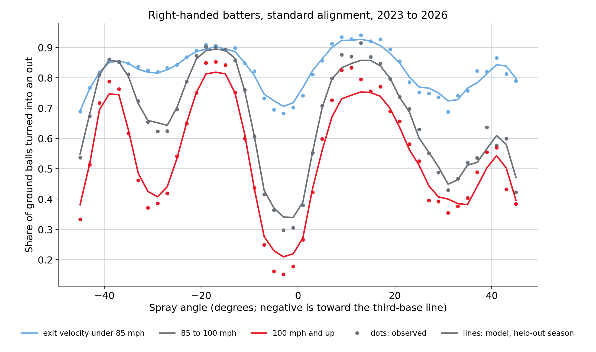
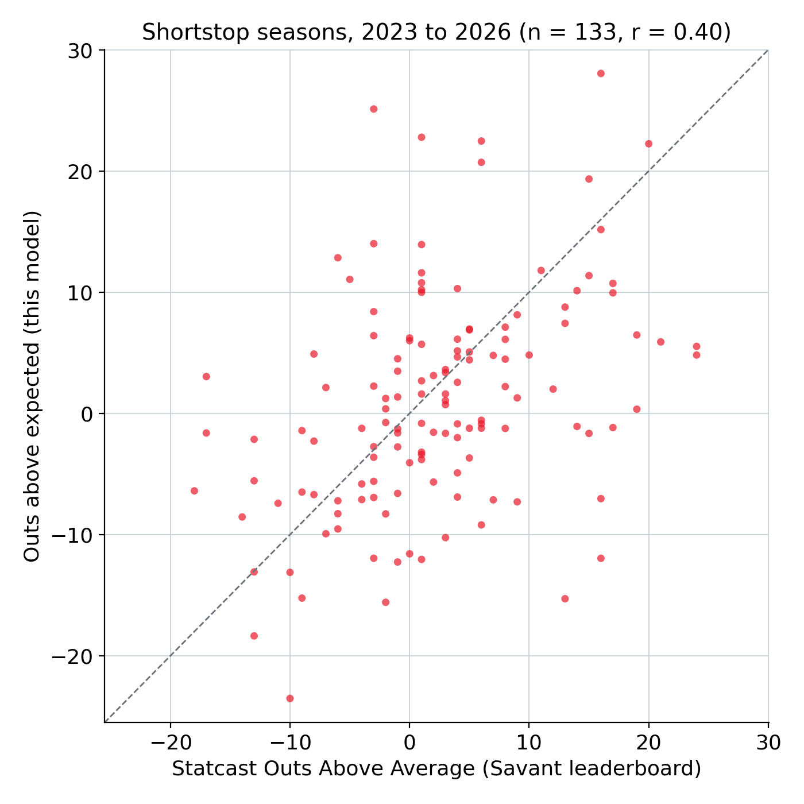
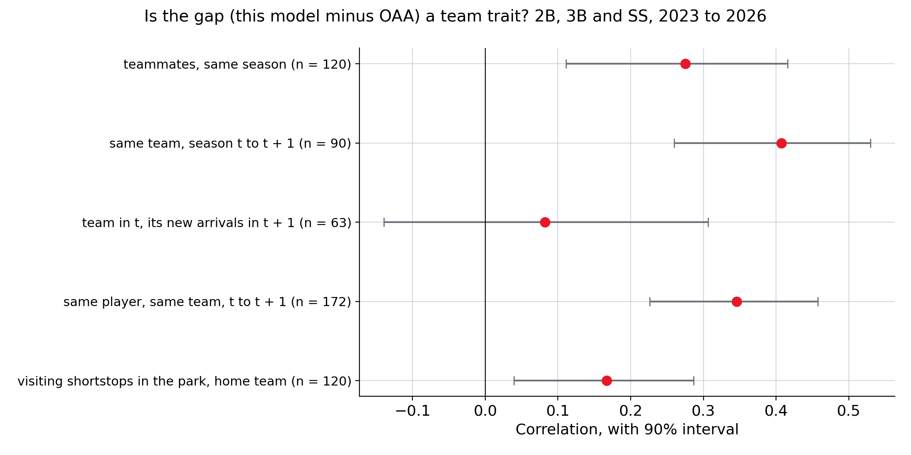
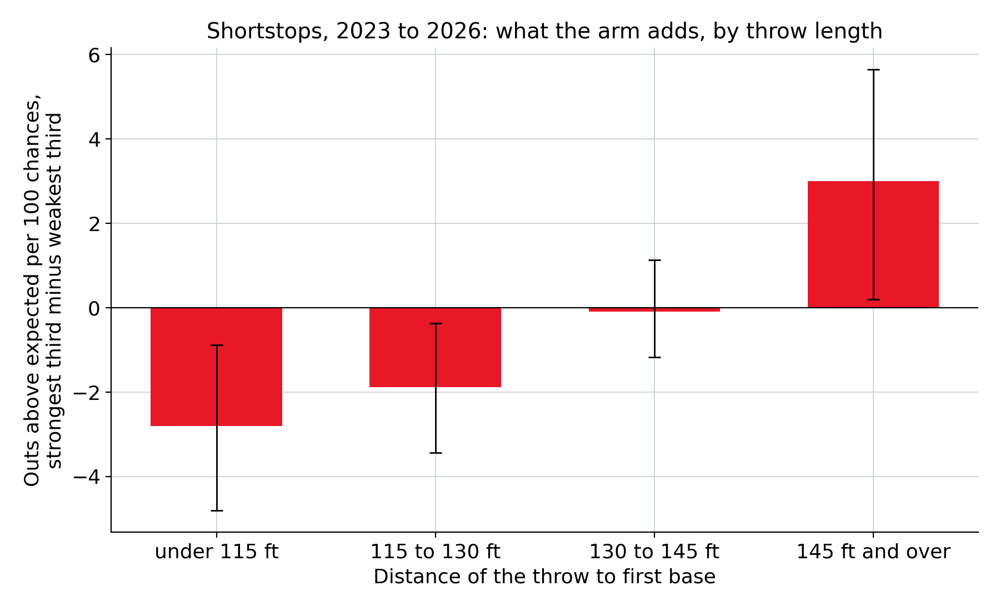
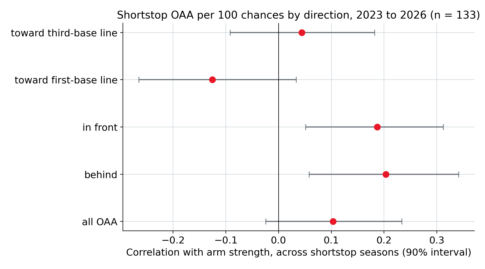
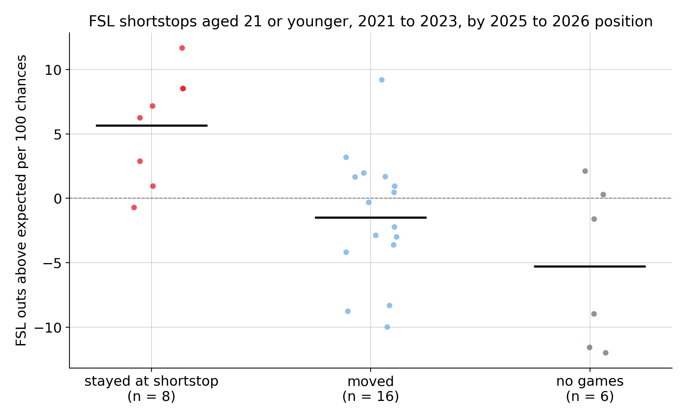
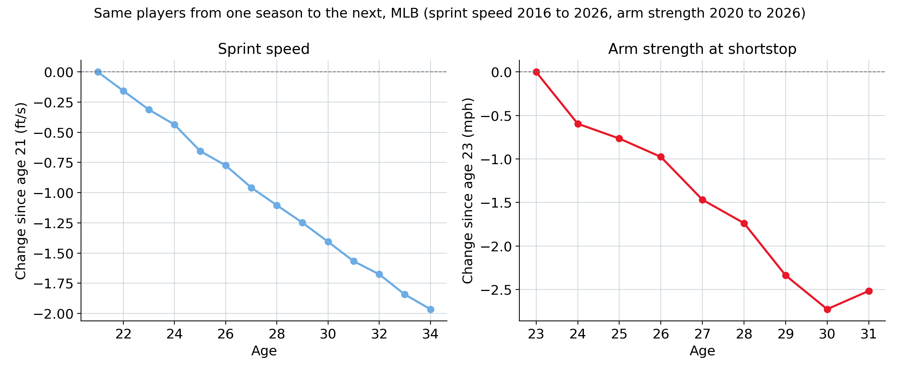

# Infield defense from public tracking data

Four analyses of infield defense, written in November 2026, that use only public data: every regular-season Major League Baseball (MLB) ground ball from 2023 to 2026 and every Florida State League (FSL, Single-A) ground ball from 2021 to 2026 from the [Baseball Savant](https://baseballsavant.mlb.com/statcast_search) pitch-level search, Savant's fielding leaderboards, and the MLB Stats API. Each script runs top to bottom in numbered steps, saves its figures next to itself, and carries its printed results pasted back in as `####` comment blocks, so the results can be read without running anything.

| Script | Question | Answer |
|---|---|---|
| `infield_expected_outs.py` | Can a ground-ball model that knows only the batted ball credit infielders the way Statcast's Outs Above Average (OAA) does? | Partly. Its fielder credit agrees with OAA at r = 0.71 at first base, 0.64 at third, 0.53 at second, and 0.40 at shortstop. |
| `team_positioning.py` | Is the difference between that model and OAA the value of the team's positioning? | Public data cannot say. Teammates share the difference within a season and it persists, but players new to a team do not take it on. |
| `shortstop_arm_tests.py` | Does a shortstop's arm strength show up where the physics of the throw says it should? | Only on the longest throws: the strongest third of arms gained 3.0 outs per 100 chances over the weakest third on throws of 145 feet or more, and lost 2.8 on throws under 115 feet. |
| `fsl_shortstops.py` | How much does one FSL season say about a young shortstop, and did it predict who stayed at shortstop? | One FSL season is more reliable (0.62) than one MLB season (0.44). In a small cohort it separated the 8 shortstops who stayed at the position from the 16 who moved (area under the curve 0.85); age did not (0.47). |

## A ground-ball model that ignores the fielders

`infield_expected_outs.py` fits the probability that a ground ball becomes an out (any runner retired) from exit velocity, launch angle, spray angle, batter side, the batter's sprint speed, the runners and outs, and Savant's infield alignment label. It uses gradient-boosted trees (scikit-learn's `HistGradientBoostingClassifier`), and every probability comes from a model trained on the other three seasons. Without bunts, 206,205 ground balls remain, 73.0 percent of them outs. Spray angle comes from Savant's hit coordinates, and only their direction is used, because the distance of the fielding spot from home plate gives the result away.

Each group of inputs was kept only after it lowered the held-out Brier score (the mean squared error of the probability): 0.19725 for the league rate alone, 0.16806 with exit velocity and launch angle, 0.14288 with spray angle and batter side, 0.14263 with sprint speed, and 0.14002 with runners, outs and alignment. Spray angle does most of the work after the exit velocity. In each tenth of predicted probability the observed out rate is within 0.8 points of the prediction, except the lowest tenth (21.65 percent predicted, 19.49 observed).

*Figure 1 of `infield_expected_outs.py`. Right-handed batters in the standard alignment. Dots are observed out rates in 2-degree bins, lines the held-out model. The dips are the holes: between third base and shortstop near −30 degrees, up the middle at 0, and between first and second base near +30. A ground ball hit 100 mph or harder up the middle is usually a hit, and the model slightly overrates the chance of an out there.*

Credit goes to the infielder who fielded the ball (the scorer's position number). A ball that reached the outfield is shared among the four infielders in proportion to who fields balls hit the same way (2-degree spray-angle bin, batter side, alignment, and exit-velocity band). Each fielder is then measured against the average fielder at his position that season. A first version shared those balls with the pitcher and catcher too, which gave the pitcher about 31 percent of the blame for balls through the middle. Fixing that balanced the league totals by position but did not raise the agreement with OAA (the script prints both versions and their shares).

*Figure 2. Shortstop seasons with at least 150 chances, 2023 to 2026 (n = 133). The model's outs above expected (OAE) against Savant's OAA, r = 0.40. At the other positions r is 0.71 (first base), 0.64 (third) and 0.53 (second).*

OAA starts from where each fielder stood. This model does not know where he stood, so a well-positioned fielder gets credit here that OAA gives to his team. That is the largest known difference between the two, and the reason for the next analysis. From one season to the next, the model's shortstop credit correlates at 0.30 (OAA 0.36) and its second-base credit at 0.50 (OAA 0.43), but at third base it is much less stable than OAA (0.18 against 0.52).

## Positioning, or the fielder?

`team_positioning.py` tests whether the gap (this model's OAE minus OAA, per 100 chances) behaves like a team trait, which is what the value of team positioning would look like. Fielder seasons at second, third and shortstop with at least 100 chances on one team.

*Figure 1 of `team_positioning.py`. Correlations of the gap with 90 percent bootstrap intervals. Teammates at the other two positions share it within a season (r = 0.28), and none of 1,000 shuffles of the team labels reached that value. A team's average persists into the next season (0.41), but the players new to the team do not take it on (0.08, interval −0.14 to 0.31), while players who stayed keep theirs (0.35). Visiting shortstops in the same park show some of it (0.17), so the park carries a part.*

The within-season sharing fits positioning, the park, or something else common to a team-season, but the failure to pass to new arrivals argues against a lasting organizational skill. Separating positioning from the fielder needs the fielders' starting positions on every play, which Savant publishes only as season averages. As a ceiling, a persistent team component of this size would be worth about 11 outs (8 runs, at 0.717 runs per ground-ball out from Statcast's run expectancy) per team season at the three positions.

## Arm strength and the length of the throw

`shortstop_arm_tests.py` starts from arithmetic. At league depth (148 feet against right-handed batters), a throw to first is 106 feet from directly behind second base and 146 feet from 8 degrees beyond the shortstop's usual angle toward third. Four mph more arm saves 0.039 and 0.054 seconds on those throws, which is 1.1 and 1.5 feet of the batter's run at the average batter's sprint speed (27.35 feet per second). If arm strength matters through the throw, its value should grow with distance.

*Figure 1 of `shortstop_arm_tests.py`. Shortstop seasons split into thirds by Savant arm strength (2023 to 2026, 252 seasons). Outs above expected per 100 chances, strongest third minus weakest, with 90 percent intervals that resample shortstop seasons: −2.8 under 115 feet, −1.9 from 115 to 130, −0.1 from 130 to 145, and +3.0 (0.2 to 5.7) at 145 feet and over.*

A play-level logistic regression with the expected-out model as an offset says the same: the interaction of arm strength with throw distance is +0.0446 (90 percent interval 0.0140 to 0.0765), and the arm's main effect is slightly negative. The interaction with the runner's speed is positive but its interval includes zero. One plausible reading of the negative short-throw values is selection: a shortstop with a weak arm keeps the job only by being better at everything else.

*Figure 2. In Savant's own directional OAA, arm strength correlates with plays in front of the shortstop (r = 0.19) and behind him (0.20), where time is short or the throw long, and hardly with lateral plays toward third (0.04). With all of OAA it is 0.10.*

Teams do not play strong-armed shortstops deeper: average depth varies little (SD 1.3 feet across shortstop seasons with nobody on and no shading) and does not follow arm strength (r = −0.06, Figure 3 of the script).

## Florida State League shortstops

Savant has published Statcast tracking for every FSL park since 2021 (77,524 ground balls after cleaning). `fsl_shortstops.py` fits the same model there without batter sprint speed, which is not published for the minors. Exit velocity is missing on 12 percent of FSL ground balls, and the model treats a missing value as a value of its own.

One season of an FSL shortstop's outs above expected per 100 chances has a split-half reliability of 0.62 (games dealt at random into two halves, Spearman-Brown corrected, 42 shortstop seasons with at least 150 chances), against 0.44 for an MLB shortstop. Young shortstops differ from each other far more than major league shortstops do, so even an outcome measure separates them.

*Figure 1 of `fsl_shortstops.py`. FSL shortstops aged 21 or younger with at least 100 chances in a season from 2021 to 2023, by where they played in 2025 and 2026 (MLB Stats API, every level): stayed at shortstop (at least half their games in the field), moved, or no affiliated games. Among the 24 still playing, the FSL measure separates those who stayed from those who moved with an area under the curve (AUC) of 0.85 (90 percent interval 0.70 to 0.98); playing time at shortstop that season gives 0.66 (0.43 to 0.87), and age 0.47.*

This is a small cohort, and the clubs saw the same defense (with better data) when they decided who moved, so the measure partly predicts their decisions. It does show that one season of Single-A defense, measured from public data alone, carries real information about who stays at shortstop.

*Figure 2. Same MLB players from one season to the next. Sprint speed falls about 0.16 feet per second a season from age 21 (1,092 player pairs at ages 22 to 26). Shortstop arm strength did not rise in the early 20s: it fell about 0.3 mph a season from 22 to 26, on only 95 pairs.*

## Limits

The expected-out model does not know where the fielders stood, which is the main reason it differs from OAA. Hit coordinates mark where a ball was fielded, so the spray angle of a ball an infielder ranged far for is measured where he caught up with it. Savant's sprint speed, arm strength and positioning are season averages, not play by play. The FSL cohort is 30 players. Every interval is a bootstrap over seasons or players, not over plays.

## Running the scripts

Python 3 with numpy, pandas, scikit-learn, statsmodels and matplotlib (tested with pandas 3.0.5, scikit-learn 1.9.0, statsmodels 0.14.6). Run in this order, because the later three read what the first one saves:

    python infield_expected_outs.py    # about 2 minutes after the first run, which downloads about 175 MB from Savant
    python shortstop_arm_tests.py      # under a minute
    python team_positioning.py         # under a minute
    python fsl_shortstops.py           # about 4 minutes; downloads the FSL ground balls and Stats API records on the first run

`python paste_results.py <script>` runs a script step by step and replaces each `####` block with what that step printed, so the blocks always come from a single run. Data go in `data/` and are not committed. Every script downloads what it needs from Baseball Savant (the pitch-level search, the minors search for the FSL, and the OAA, arm strength, sprint speed and fielder positioning leaderboards) and from the MLB Stats API (`statsapi.mlb.com`).
